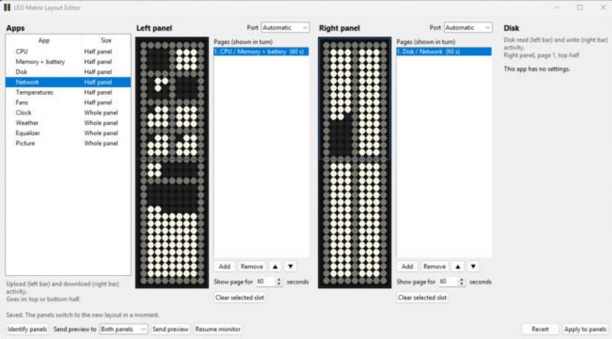
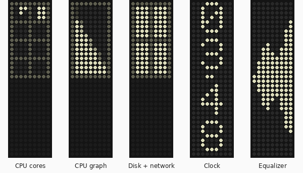

# LED Matrix Monitor for Windows (Framework 16)

A Windows port of [MidnightJava/led-matrix](https://github.com/MidnightJava/led-matrix), the LED matrix system monitor for the Framework Laptop 16 (itself based on [LED System Monitor](https://code.karsttech.com/jeremy/FW_LED_System_Monitor.git)). It shows CPU, memory, battery, disk, network, temperatures, fans, the time, the weather and more on the two LED Matrix input modules.

This version runs on **Windows 11 only**. For Linux, use the [original project](https://github.com/MidnightJava/led-matrix).

What this port adds:

* An installer and a portable `.exe` (no Python needed), with an icon in the system tray.
* A **layout editor** window for choosing which apps show on each panel, with a live preview.
* Temperatures and fans read from **Framework Control**, **Libre Hardware Monitor** or `framework_tool`, with a choice of sensors and Celsius or Fahrenheit.
* New apps: CPU graph, GPU graph, disk + network in one half panel, and an FPS counter for games.
* Every core shown on CPUs with more than eight cores.
* A brightness slider, *Stop animation*, *Start with Windows* and other tray menu items.



*The layout editor. This screenshot was taken before the newest apps were added, so their names aren't in the list yet.*



*Some of the apps, drawn by the app's own preview code (the same pictures you see in the layout editor). Half-panel apps use the top or bottom half; the clock and equalizer fill the whole panel.*

## Download and install

1. Download [`led_mon-setup.exe`](https://github.com/kingof9x/led-matrix/releases/latest/download/led_mon-setup.exe) (the installer) or [`led_mon.exe`](https://github.com/kingof9x/led-matrix/releases/latest/download/led_mon.exe) (portable, nothing is installed). Older versions are on the [Releases](https://github.com/kingof9x/led-matrix/releases) page.
2. Close other programs that use the LED panels, such as the LED Matrix Control app (`ledmatrixgui.exe`). Only one program at a time can talk to a panel.
3. Run the file. If Windows shows *"Windows protected your PC"*, click *More info* > *Run anyway* (the builds aren't code-signed yet).

The installer installs for the current user only (no admin prompt) into `%LOCALAPPDATA%\Programs\led_mon`, adds a Start menu shortcut, and makes the app **start automatically when you log in**. That's the only difference from the portable exe. You can turn auto-start on or off with *Start with Windows* in the tray menu (this works for the portable exe too), or in *Task Manager > Startup apps* (entry `led_mon`). Updating with a newer installer keeps your choice. Uninstall from *Settings > Apps*; this removes the app and the startup entry but keeps your config.

## How to use it

1. After starting, the panels show the default layout and an LED icon appears in the system tray (click `^` near the clock if you can't see it).
2. Right-click the tray icon and choose **Edit layout** to change what's shown. Drag an app from the list onto a panel. Each panel can have several *pages* that take turns. Click **Apply to panels** to save.
3. If you don't want to build a layout yourself, use **Ready-made layouts > Classic monitor**: CPU cores and memory + battery on the left panel, disk and network on the right.
4. Choose **Brightness** in the tray menu to set the brightness yourself, or leave *Follow screen brightness* ticked.
5. **Stop animation** turns the panels off until you choose *Start animation*. **Quit** turns them dark and closes the app.
6. Something not working? Choose **Open log** in the tray menu, or run `led_mon.exe --diagnose` in a command prompt to see which panels the app finds.

### Tray menu

The app runs without a window and shows an icon in the system tray (you may need to open the `^` overflow area). Left- or right-click the icon to open the tray menu:

* *Edit layout* opens the layout editor (below).
* *Brightness* pops up a small slider next to the tray. Moving it sets the panel brightness yourself; tick *Follow screen brightness* to go back to following the screen (the default). Click anywhere else or press `Esc` to close it. The choice is kept in `%APPDATA%\led_mon\settings.json`.
* *Stop animation* turns the panels off until you choose *Start animation*; the tray icon turns grey while stopped.
* *Identify panels*, *Next app* and *Freeze app switching* do the same as the keyboard shortcuts below.
* *Open Hardware Monitor* and *Open Framework Control* appear when those programs are found, and open them (or bring Open Hardware Monitor forward if it is already running). If Open Hardware Monitor is somewhere unusual, put its path in `settings.json` as `"open_hardware_monitor_path"`.
* *Open config folder*, *Open log*, *Reload config*, *Start with Windows* (a checkbox) and *Quit*. *Quit* turns the panels dark before the app exits.

Only one copy runs at a time; starting it again does nothing.

### Keyboard shortcuts

`Ctrl` + `Alt` + `Shift` with:

* `I`: show the app names in each quadrant for a few seconds
* `N`: show the next app without waiting for the time slice to end
* `F`: freeze app switching, so the current app stays on
* `U`: unfreeze app switching

They use the Windows hotkey feature, so the app only hears about these four shortcuts and never sees other keystrokes (`--no-key-listener` turns them off). The extra modifiers keep them from taking `Alt` + `F` and the like away from other programs.

### Layout editor

Instead of editing the config file by hand, open *Edit layout* from the tray menu (or *LED Matrix Layout Editor* in the Start menu, or run `led_mon.exe --edit-layout`).

* The list on the left shows the available apps. Half-panel apps (CPU cores, CPU graph, GPU graph, memory + battery, disk, network, disk + network, temperatures, fans) go in the top or bottom half of a panel; whole-panel apps (clock, weather, equalizer, FPS counter, picture) fill it.
* Each panel shows a list of *pages*, shown in turn for the number of seconds you set. Drag an app onto a panel to put it on the selected page, or select a slot and double-click an app. Click an app on the panel to change its settings on the right.
* The panel pictures are a live preview, drawn with the same code as the real panels and your computer's current values. The equalizer preview shows made-up bars.
* *Apply to panels* saves the layout to `%APPDATA%\led_mon\config-local.yaml` (the previous file is kept as `config-local.yaml.bak`) and the running app switches to it straight away.
* *Send preview* shows the current preview on the panels as a still picture for 30 seconds (or until *Resume monitor*), without saving. When the app isn't running, the editor sends the picture to the panels itself.
* The *Brightness* slider under the app list changes the panel brightness straight away (no need to Apply), the same as the tray slider.
* *Ready-made layouts* fills both panels in one go. *Classic monitor* is the same as the LEDmatrix monitor tool: CPU cores, memory and battery on the left; disk and network on the right. Press *Apply to panels* to use it.
* The *Port* boxes pin a panel to one of the connected LED panels, in case they are detected in the wrong order. Each entry shows the COM port and the panel's USB position, for example `COM4 (USB 1-4.2)`. The editor saves the USB position (the `left-location` / `right-location` settings), which stays the same even if Windows gives the panel a different COM number. This takes effect the next time the app starts.

### Temperatures and fans

Windows has no standard way to read the laptop's temperatures and fans, so the Temperatures and Fans apps read them from one of these. Click the Temperatures or Fans app on a panel in the layout editor and choose under **Read from**:

* **Automatic** (the default): tries Framework Control, then Libre Hardware Monitor, then `framework_tool`, and uses the first one that gives readings.
* **Framework Control**: needs [Framework Control](https://github.com/ozturkkl/framework-control) installed. Its service runs in the background, so nothing has to be open and no admin rights are needed. On a Framework 16 it gives the CPU, APU, ambient and charger temperatures and both fans.
* **Libre Hardware Monitor**: needs [Libre Hardware Monitor](https://github.com/LibreHardwareMonitor/LibreHardwareMonitor) open (it can sit in the tray) and running as administrator. Which sensors show depends on the laptop: GPU and SSD temperatures are likely, fans may be missing.
* **framework_tool**: needs `framework_tool.exe` from the [framework-system releases](https://github.com/FrameworkComputer/framework-system/releases) next to `led_mon.exe` (for the installed app: `%LOCALAPPDATA%\Programs\led_mon`) or on your `PATH`, and led_mon itself running as administrator.

**Read every** sets how often the sensors are read (1 to 30 seconds). Both choices are kept in `%APPDATA%\led_mon\settings.json` (`sensor_source` and `sensor_refresh_seconds`), and the editor shows where the current readings come from.

The **Temperatures** app shows three temperatures as numbers, one under the other (the middle one dimmer). In its settings, pick the sensor for the *Top*, *Middle* and *Bottom number* (blank picks the next one automatically, CPU first) and the unit, C or F. The **Fans** app shows the speed of both fans as bars. `led_mon.exe --diagnose` lists every sensor it can read.

**Where things live**

* Config: `%APPDATA%\led_mon\config.yaml` (copied from the default on first run). The layout editor saves to `config-local.yaml` in the same folder; if you edit that file by hand instead, choose *Reload config* from the tray menu afterwards.
* API keys for the weather app: `%APPDATA%\led_mon\.env` (see `.env-example`).
* Log: `%LOCALAPPDATA%\led_mon\led_mon.log` (rotated at 1 MB, 3 old files kept). Set `LOG_LEVEL=debug` in the `.env` file for more detail.
* If the panels are detected in the wrong order, pick the right one in the layout editor's *Port* boxes, or set `left-location: 1-4.2` / `right-location: 1-3.3` (USB positions) or `left-port: COM4` / `right-port: COM5` in the config. If a pinned panel isn't found, the app picks one automatically.
* To see what the app finds, run `led_mon.exe --diagnose` from a command prompt. It lists the serial ports (with USB position and USB id), which panel it would use as left and right, whether it found Open Hardware Monitor and Framework Control, and where temperatures and fans are read from. It works while the app is running too.
* Close other programs that use the panels (such as the LED Matrix GUI, `ledmatrixgui.exe`) before starting the app: only one program can open a panel's port at a time.

## Apps

Half-panel apps go in the top or bottom half of a panel; whole-panel apps fill it. Each quadrant can have several apps that take turns. You can set them up in the layout editor, or by hand in the config file (see `led_mon/config-README.md`).

* Half panel: CPU cores, CPU graph, GPU graph, memory + battery, disk, network, disk + network, temperatures, fans
* Whole panel: clock, weather, equalizer, FPS counter, picture (patterns saved in snapshot JSON files)

Settings for some of the apps, as they appear in the config file:

### Time (provided by `time_weather_plugin.py`):
Configure the following arguments in the config file (`app->args`)

`fmt_24_hour: true|false`

### Weather (provided by `time_weather_plugin.py`):
Specify app arguments in the config file as described below.
Set arguments (`app -> ags`) for the `weather` app in the desired quadrant
  - Weather provider behavior:
    - Primary provider: OpenWeather (used when `OPENWEATHER_API_KEY` is set)
    - Automatic fallback provider: Open-Meteo (no API key required)

  - Environment variables:
    - `OPENWEATHER_API_KEY` (optional): enables OpenWeather as primary provider.
    - `IP_LOCATE_API_KEY` (optional): enables IPLocate-based IP geolocation when you do not set `lat_lon` or `zip_info`.
      If this is not set, the app will fall back to keyless IP geolocation providers.
  - To enable online lookup of local weather information, the app must know your location. Choose one or more of the options.

    1) Specify country-specific zip and [ISO 3166 digraph code](https://www.iban.com/country-codes)
    
         `zip_info: ["your zip", "country code"]`

    2) Specify latitude and longitude direclty

         `lat_lon: [<lat>, <lon>]`

    3) Set env var IP_LOCATE_API_KEY in `.env`. Get a free API key from https://iplocate.io
       
  - Display temperature in Celsius, Farenheit, or Kelvin. Default is metric

    `units: imperial|metric|standard`
  - If weather is configured with `scope: panel`, it owns the full panel while active and the sibling quadrant on that side is suppressed by the scheduler.
    For predictable rotation, configure one panel-scope app per side and set the sibling app to `display: false`.
  - Show current or forecast weather. Default is current

    `forecast: true|false`
  - Set day offset (GMT time) for forecast (max 5, default 1)

    `forecast_day: n`
  - Set Hour offset (GMT time) for forecast on selected day. One of 0, 3, 6, 9, 12, 15, 18, 21. default is 12
    If selected time is more than 5 * 24 hours from present time, the latest available forecast will be shown

    `forecast_hour: n`
  - Override the key used to display the app ID. This means if forecast is true, use weather_forecast, otherwise use weather_current

  - Specify measures to show. If more than one is provided, the app will cycle through them indefinitely
    
    `measures: [temp_condition, wind_chill, wind]`
  - Specify the number of seconds to display each measure.
    
    `measures-duration: 20`

    `id_key_override: [forecast, weather_forecast, weather_current]`

    If `forecast` is true, the `Forecast Days` and `Forecast Hours` settings will be shown at the bottom left and right edges of the LED device. The `Forecast Days` value will be indicated by 1 to 5 pixels stacked from the bottom on the left edge. The `Forecast Hours` will be indicated by one to 8 pixels stacked from the bottom on the right edge, each representing the three-hour periods from 0 to 21. A hash mark will be drawn in the adjacent column at the fourth pixel, if lit, for ease of reading.

### CPU and GPU graphs (built-in apps `cpu-graph` and `gpu-graph`):
Each row of the half panel is one second, newest at the top, and the length of the row is how busy the CPU or GPU was in that second (the last pixel is dimmer for a part-filled row). The CPU graph is the overall use of all cores, as in Task Manager.

The GPU graph reads the same counters as Task Manager (the busiest engine of the GPU). To pick a GPU when there are several, set `gpu` to its name (the layout editor lists them):

  `gpu: AMD Radeon RX 7700S`

Without `gpu`, the first GPU found is shown (usually the one driving the built-in screen).

### Disk + network (built-in app `disk-net`):
The upper part shows disk read (left bar) and write (right bar), the lower part network upload (left) and download (right), like the `disk` and `net` apps in half the space.

### CPU cores (built-in app `cpu`):
One spiral per physical core, for up to eight cores. CPUs with more cores (such as the 12-core Ryzen AI 9 HX 370) get a bar per core instead, so every core is shown.

### FPS counter (built-in app `fps`)
 The `fps` app shows the frames per second of a game, with a graph of the last few seconds below. It follows whichever app is in front, or set *App to watch* in the layout editor to a program's file name (such as `eldenring.exe`). It uses Intel's [PresentMon](https://github.com/GameTechDev/PresentMon) (MIT licence), which the installer puts next to `led_mon.exe`. With the portable exe, download the console exe (`PresentMon-<version>-x64.exe`) from the [PresentMon releases](https://github.com/GameTechDev/PresentMon/releases), rename it to `PresentMon.exe` and put it next to `led_mon.exe`.

Windows only lets programs read frame timing when they run as administrator or the account is in the *Performance Log Users* group. One-time setup: open *Terminal (Admin)* or *PowerShell (Admin)* from the Start button's right-click menu, run

```powershell
Add-LocalGroupMember -SID S-1-5-32-559 -Member "$env:USERDOMAIN\$env:USERNAME"
```

then sign out and back in (S-1-5-32-559 is that group in every Windows language). Until then the app shows a `?` and the log says why.


### Snapshot (built-in app, not a plugin):
Configure the following arguments in the config file (`app -> args`)
- Name of the JSON file with a pattern to display

  `file: <file name>`
- The file path relative to the module dir (`led_mon`)

  `path: <path>`
- The sudbir of the file, relative to `path`

  `panel: left|right|<xxx>`

### Equalizer (provided by `equalizer_plugin.py`)
The equalizer is effectively panel-wide per side (`left` or `right`) because it writes directly to the LED device for that side.
If configured as `scope: panel`, the scheduler enforces panel ownership and suppresses the sibling quadrant while it is active.
Set the following app settings. These are direct properties of the equalizer app, not args
- Set to true if the app will handle drawing to the grid the entire time it is active. If false, the app draws a static snapshot on every invocation. Default is false

  `persistent-draw: true|false`
- Since the equalizer draws continuously to the LED panel, this function (specified in `app_funcs`), is invoked to pause the equalizer when its duration peroiod expires

  `dispose-fn: equalizer_dispose`

Configure the following arguments in the config file (`app -> args`)
- Select the equalizer input source mode.
  - `playback` (default): whatever is playing on the default output device (speakers or headphones); it follows a switch between them.
  - `microphone`: captures microphone input (recommended to dedicate a panel/quadrant for this mode).

  `input-mode: playback|microphone`
- Optional input device override used primarily with `input-mode: microphone` (matches an input device name).

  `input-device: <device-name-or-index>`
- Per-band gain multiplier applied after band energy detection.
  - Default `1.35` for `playback` (improves low-volume responsiveness).
  - Default `0.75` for `microphone` (reduces ambient mic sensitivity).

  `level-gain: <float>`
- Per-band minimum level threshold after gain. Bands below this value are forced to zero.
  - Default `1` for `playback`.
  - Default `18` for `microphone` (reduces ambient mic noise spikes).

  `noise-gate-level: <int>`
- Total level sum threshold used to treat frames as silent (for pulse idle transitions).
  - Default `2` for `playback`.
  - Default `48` for `microphone`.

  `silence-level-sum-threshold: <int>`
- Identify which physical panel side this equalizer instance controls. Used for instance identity/dispose handling.
  Run playback and microphone equalizers as separate app instances and assign each to its own panel/quadrant time slice.

  `side: left|right`
- Delay (seconds) before entering pulse-only silent visuals when levels drop to zero.

  `zero-frame-delay-sec: <seconds>`
- Pulse start delay (legacy alias retained for compatibility). The lower of this and `zero-frame-delay-sec` is used.

  `silent-pulse-after-sec: <seconds>`
- Pulse period for long-silence mode (center-origin star-like ripple pulse).

  `silent-pulse-period-sec: <seconds>`
- Time for gradually revealing the inverted `EQ0` mask during long silence while pulsing.

  `silent-pulse-reveal-sec: <seconds>`

## SmartScreen and antivirus

The builds are not code-signed yet, so Windows may show *"Windows protected your PC"* the first time. Click *More info* > *Run anyway*.

Some antivirus engines flag unsigned programs packaged with PyInstaller, because malware is often packaged the same way. To reduce this, the release builds compile PyInstaller's launcher from source instead of using the shared prebuilt one, don't compress the exe with UPX, and carry version details. The keyboard shortcuts use registered hotkeys rather than watching every keystroke. If a scanner still flags a build from this repository's Actions, the installer usually gets fewer flags than the portable exe.

## Build it yourself

Windows, Python 3.12:

```powershell
git clone <repository-url>
cd led-matrix
py -3.12 -m venv .venv
.venv\Scripts\activate
$env:PYINSTALLER_COMPILE_BOOTLOADER = "1"; python -m pip install --no-binary pyinstaller pyinstaller   # optional: own launcher (needs Visual Studio Build Tools)
python -m pip install -r requirements.txt pyinstaller pytest
python -m pytest
python -m led_mon.led_system_monitor --no-tray          # run from source in the console
python -m led_mon.led_system_monitor --edit-layout      # the layout editor
python -m PyInstaller led_mon.spec --noconfirm            # one-dir build: dist\led_mon\led_mon.exe
$env:LED_MON_ONEFILE = "1"; python -m PyInstaller led_mon.spec --noconfirm --workpath build\onefile   # dist\led_mon.exe
# Installer (needs Inno Setup 6):
& "${env:ProgramFiles(x86)}\Inno Setup 6\ISCC.exe" /DAppVersion=2.1.2 installer\led_mon.iss   # dist\led_mon-setup.exe
```

**Making a release:** in GitHub go to *Actions > Windows build > Run workflow*, type a version such as `1.0.0`, and run it. When it finishes, the release `v1.0.0` appears on the Releases page with both files attached. Pushing a tag such as `v1.0.0` does the same. Leaving the version empty makes a test build without a release.

## Plugins

The apps can be extended with plugins. See `led_mon/plugins/plugins-README.md`.

## Project status

**Status:** Testing  
**Notes:** Windows port of the led_mon system monitor.  
**Last updated:** 2026-11-02

### Things to test

The app has been used daily without problems. These are the parts that changed since then:

- [ ] Temperatures app: shows three numbers with each *Read from* choice (Automatic, Framework Control, Libre Hardware Monitor, framework_tool)
- [ ] Temperatures app: picking sensors for the top, middle and bottom numbers, and switching between C and F
- [ ] Fans app: both fans move with the fan speed
- [ ] *Read every* changes how often the numbers update
- [ ] `led_mon.exe --diagnose` lists the temperature and fan sources and sensors
- [ ] Quick check that nothing else changed: equalizer, keyboard shortcuts, battery charging animation, brightness following the screen
